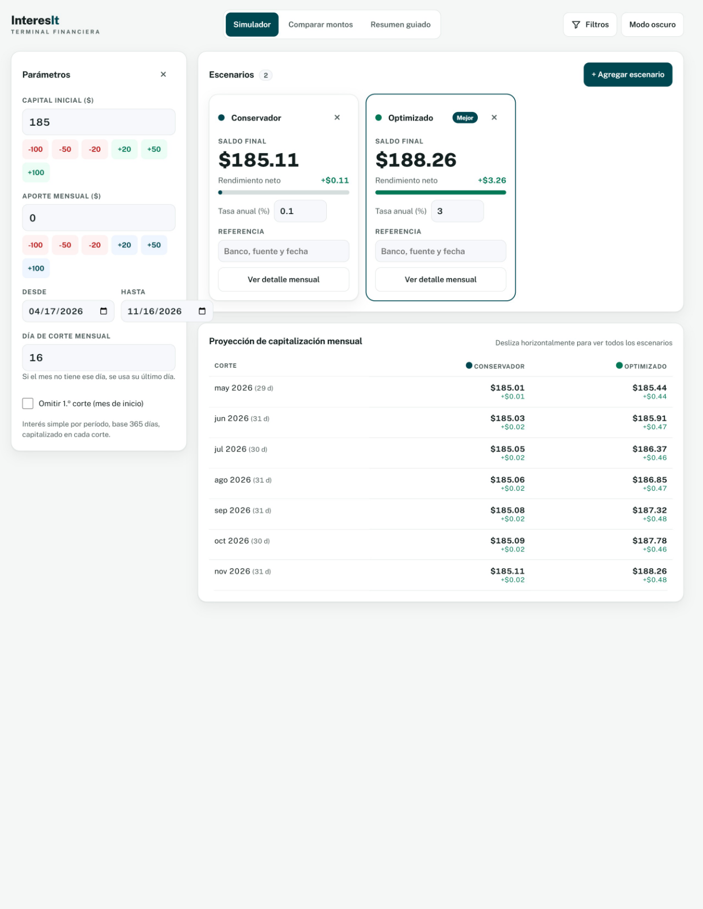
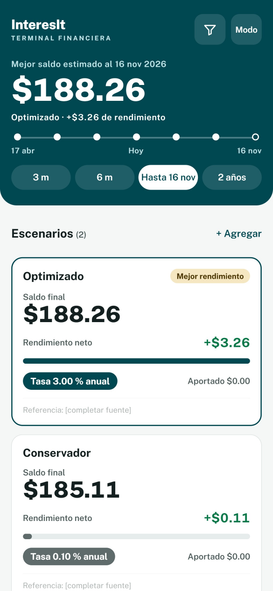
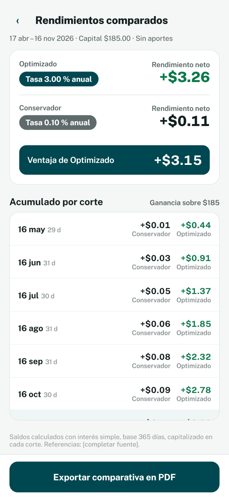
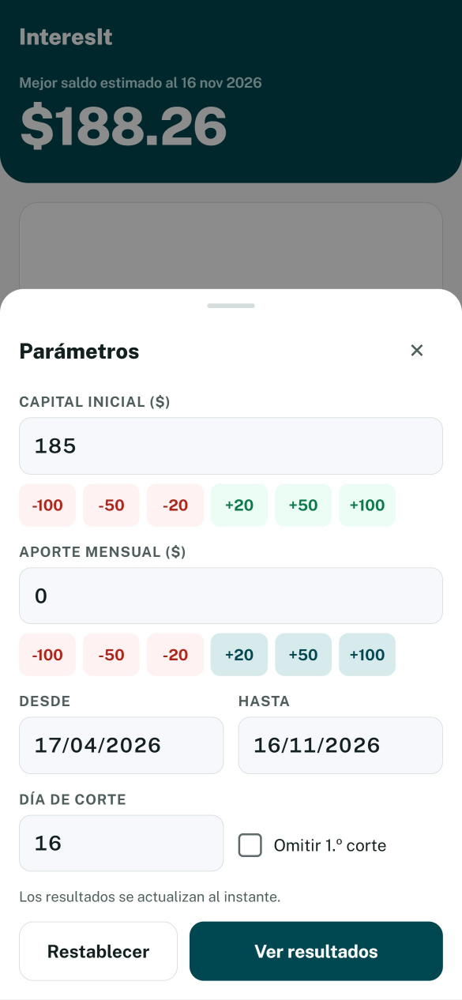
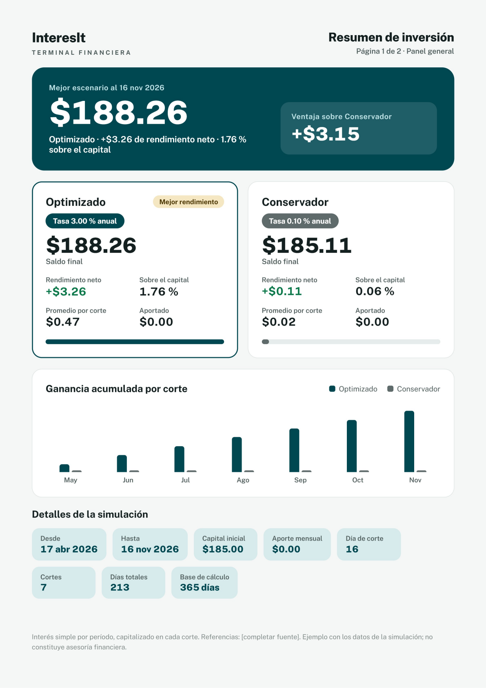
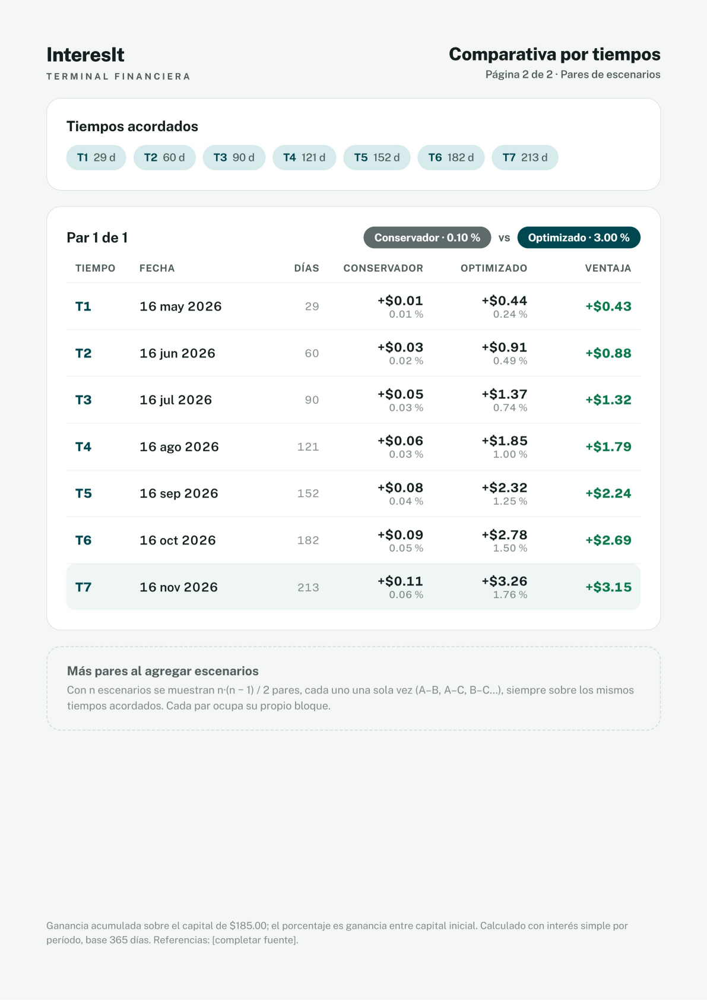
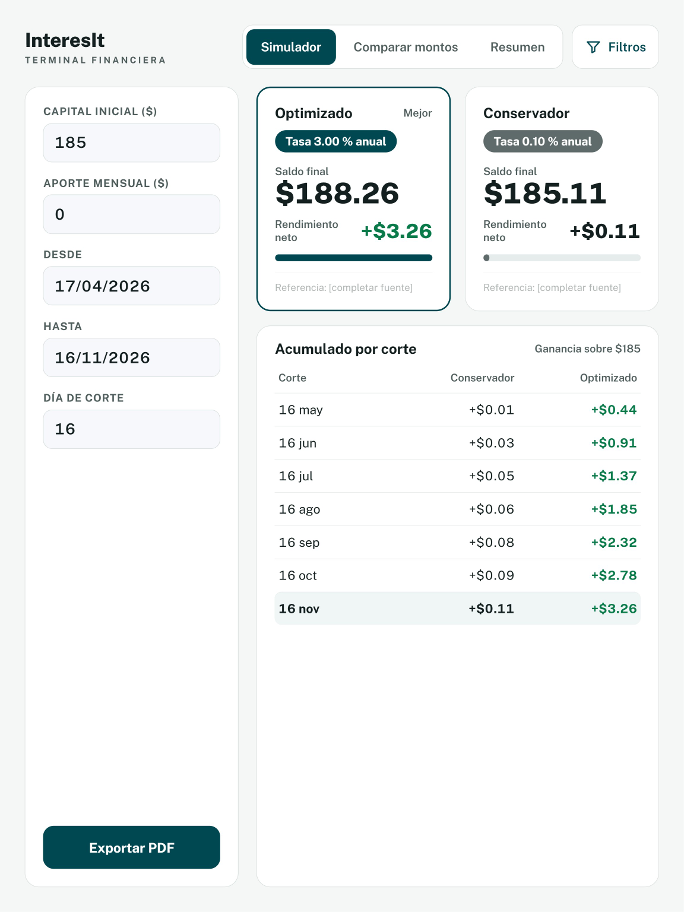
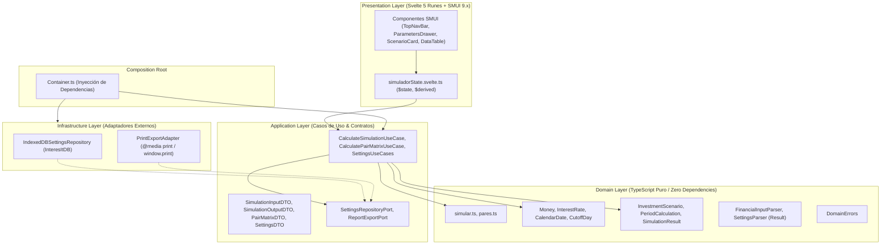
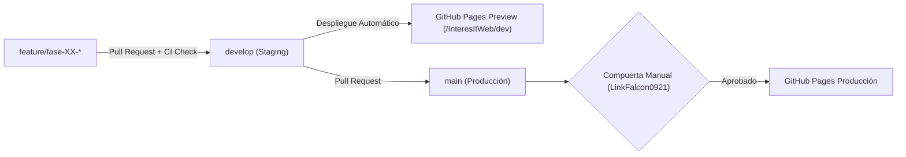

# InteresIt: Terminal Financiera

<div align="center">


**Terminal financiera de alta precisión y calculadora multiescenario de interés compuesto.**  
Proyecciones de capital basadas en fechas reales de calendario, cortes bancarios, retención fiscal dominicana y comparativa combinatorial de estrategias de inversión.

[-FF3E00?logo=svelte&logoColor=white)](https://svelte.dev)
[-3178C6?logo=typescript&logoColor=white)](https://www.typescriptlang.org)
[](https://nodejs.org)
[](https://pnpm.io)
[](https://sveltematerialui.com)
[](https://vitest.dev)
[](#-arquitectura-de-software-clean-architecture)
[](LICENSE)

</div>

---

## 📌 Tabla de Contenidos

1. [Visión General](#-visión-general)
2. [Vistazo a la Interfaz Visual](#-vistazo-a-la-interfaz-visual)
3. [Reglas Financieras y Matemáticas del Core](#-reglas-financieras-y-matemáticas-del-core)
4. [Arquitectura de Software (Clean Architecture)](#-arquitectura-de-software-clean-architecture)
5. [Catálogo de Módulos](#-catálogo-de-módulos)
6. [Flujo Git y Estrategia CI/CD](#-flujo-git-y-estrategia-cicd)
7. [Estado del Proyecto y Fases de Migración](#-estado-del-proyecto-y-fases-de-migración)
8. [Guía de Inicio Rápido](#-guía-de-inicio-rápido)

---

## 🌟 Visión General

**InteresIt** es una Single Page Application (SPA) ejecutada al 100% en el cliente, concebida para inversionistas, asesores patrimoniales y profesionales que requieren modelar proyecciones de capital con rigor financiero institucional.

A diferencia de calculadoras tradicionales que asumen meses genéricos de 30 días, InteresIt simula los ciclos reales del sistema financiero:
- **Fechas Exactas en UTC:** Cálculo día por día según el calendario astronómico (incluyendo años bisiestos).
- **Día de Corte Bancario:** Capitalización periódica exacta según el día de corte de la entidad (con ajuste automático al último día válido del mes).
- **Omisión Condicional de 1.º Corte:** Simulación realista para aperturas o depósitos efectuados a finales de mes.
- **Retención Fiscal de República Dominicana:** Deducción automática del 10% sobre los intereses brutos generados (Ley 253-12).
- **Matriz de Comparación Multiescenario:** Evaluación simultánea de hasta 20 escenarios de inversión con detección automática del líder, cálculo de ventaja monetaria y matriz de pares combinatoria $n(n-1)/2$.
- **Reportes Ejecutivos A4 Listos para Imprimir:** Generación de informes de 2 páginas con diagramación CSS pura (`@media print`) sin librerías pesadas externas.

---

## 📸 Vistazo a la Interfaz Visual

El diseño visual está fundamentado en el sistema institucional de fondos de inversión (**Excel SAFI**), implementado con **Svelte Material UI (SMUI 9.x)**, tokens institucionales y cifras tabulares (`Public Sans`).

### 1. Simulador Principal (Escritorio)
Panel integral con parámetros laterales, tarjetas de escenarios dinámicos y tabla de desglose mensual por fecha de corte.



### 2. Experiencia Móvil Optimizada
Tarjeta Hero de alto impacto con el mejor saldo estimado, chips de horizontes temporales y navegación fluida por escenarios.

| Tarjeta Hero y Escenarios | Comparativa de Rendimientos | Drawer de Parámetros |
| :---: | :---: | :---: |
|  |  |  |

### 3. Reporte Ejecutivo de Inversión A4 (2 Páginas)
Reporte institucional de alta fidelidad maquetado para impresión directa en formato A4 o guardado en PDF:

| Página 1: Panel General y Gráfico de Acumulados | Página 2: Matriz Comparativa por Tiempos |
| :---: | :---: |
|  |  |

### 4. Vista Adaptativa para Tablets
Visualización en columna única que equilibra el ingreso de datos con las tarjetas de rendimiento y la matriz por corte.



---

## 📐 Reglas Financieras y Matemáticas del Core

La lógica de negocio se ejecuta de forma pura y determinista bajo las siguientes especificaciones:

### 1. Variables de Entrada
- **Capital Inicial ($P$):** Inversión base ($P \ge 0$).
- **Aporte Recurrente Mensual ($PMT$):** Monto aportado en cada ciclo de corte ($PMT \ge 0$).
- **Horizonte Temporal:** Fecha de inicio (`Desde`) y fecha límite (`Hasta`), con validación estricta `Desde < Hasta` en tiempo UTC.
- **Día de Corte Mensual (`diaCorte`):** Entero entre `1` y `31`. Si el mes contiene menos días (ej. 28 de febrero o 30 de abril), se ajusta automáticamente al último día del mes respectivo.
- **Omitir 1.º Corte (`omitirPrimerCorte`):** Si está activo y el primer ciclo es parcial respecto a los días totales del mes, el interés devengado en ese ciclo es $0$.
- **Retención Fiscal RD (`aplicarImpuestoRD`):** Retención por ley del 10% sobre el interés bruto devengado.

### 2. Ecuaciones de Capitalización

1. **Días exactos del período:**
   $$d = \text{fechaCorte}_{t} - \text{fechaCorte}_{t-1}$$

2. **Interés bruto devengado (base 365 días reales):**
   $$I_{\text{bruto}} = \text{balance}_{t-1} \times \left(\frac{\text{tasaAnual}}{100}\right) \times \left(\frac{d}{365}\right)$$

3. **Interés neto efectivo:**
   $$I = \begin{cases} 
   0 & \text{si es omitido en el primer corte} \\ 
   I_{\text{bruto}} \times 0.90 & \text{si aplica retención fiscal RD (10%)} \\ 
   I_{\text{bruto}} & \text{sin retención fiscal} 
   \end{cases}$$

4. **Balance acumulado por período:**
   $$\text{balance}_{t} = \text{balance}_{t-1} + I + PMT$$

5. **Rendimiento neto final:**
   $$\text{Rendimiento Neto} = \text{Balance Final} - \left(P + \sum PMT\right)$$

6. **Comparativa combinatorial de pares:**
   Para $n$ escenarios configurados, se generan exactamente todas las parejas únicas sin repetición:
   $$\text{Total Pares} = \frac{n(n - 1)}{2}$$

---

## 🏗 Arquitectura de Software (Clean Architecture)

El proyecto adopta **Clean Architecture** y principios de **Domain-Driven Design (DDD)** para aislar completamente las reglas de negocio de los detalles de infraestructura y presentación.



### Reglas de Dependencias y Aislamiento:
- **`$domain`:** TypeScript puro sin ninguna dependencia externa ni imports de capas superiores.
- **`$application`:** Contiene casos de uso, DTOs y puertos abstractos. Solo importa de `$domain`.
- **`$infrastructure`:** Implementa los puertos técnicos (persistencia en IndexedDB y exportación de reportes).
- **`$presentation`:** Componentes de interfaz en Svelte 5 con Runes (`$state`, `$derived`, `$props`) y SMUI. Solo interactúa con `$application`.
- **`$di`:** Composition Root que ensambla las dependencias concretas.

---

## 📦 Catálogo de Módulos

| Capa | Módulo | Ruta | Propósito |
| :--- | :--- | :--- | :--- |
| **Domain** | `simular.ts` | `src/lib/domain/finance/simular.ts` | Motor puro de proyección temporal con días exactos en UTC, base 365 y clamping de corte. |
| **Domain** | `pares.ts` | `src/lib/domain/finance/pares.ts` | Algoritmo combinatorial sin repetición $n(n-1)/2$. |
| **Domain** | `Value Objects` | `src/lib/domain/value-objects/` | `Money`, `InterestRate`, `CalendarDate`, `CutoffDay` (validación en construcción). |
| **Domain** | `Parsers` | `src/lib/domain/parsers/` | `FinancialInputParser`, `SettingsParser` con retornos seguros `Result<T, E>`. |
| **Application** | `CalculateSimulationUseCase` | `src/lib/application/use-cases/` | Orquesta la simulación concurrente de múltiples escenarios y detecta al líder. |
| **Application** | `CalculatePairMatrixUseCase` | `src/lib/application/use-cases/` | Calcula la matriz comparativa de ventajas entre pares de escenarios. |
| **Application** | `SettingsUseCases` | `src/lib/application/use-cases/` | `LoadSettingsUseCase` y `SaveSettingsUseCase` para gestión de configuración. |
| **Application** | `DTOs & Ports` | `src/lib/application/dtos/`, `ports/` | Contratos tipados y puertos abstractos desacoplados de la tecnología. |
| **Infrastructure** | `IndexedDBSettingsRepository` | `src/lib/infrastructure/persistence/` | Persistencia nativa offline compatible con la base `InteresItDB`. |
| **Infrastructure** | `PrintExportAdapter` | `src/lib/infrastructure/export/` | Adaptador para emisión del reporte ejecutivo A4 de 2 páginas. |
| **Presentation** | `simuladorState.svelte.ts` | `src/lib/presentation/state/` | Store reactivo global gobernado por runes de Svelte 5. |
| **Presentation** | `Components` | `src/lib/presentation/components/` | Componentes institucionales SMUI (`layout/`, `simulator/`, `export/`, etc.). |

---

## 🔀 Flujo Git y Estrategia CI/CD

El repositorio implementa un flujo de entrega continua gobernado con compuertas de seguridad:



1. **Tronco de Integración (`develop`):** Todas las fases se integran mediante Pull Requests con validación estricta de CI (`pnpm test`, `pnpm check`, `pnpm check:lines`). El merge a `develop` despliega automáticamente el entorno de staging.
2. **Rama de Producción (`main`):** El pase de `develop` a `main` requiere aprobación manual obligatoria por el reviewer designado (`LinkFalcon0921`) antes del despliegue en producción.

---

## 🚀 Estado del Proyecto y Fases de Migración

| Fase | Identificador | Nombre de Fase | Estado | Cobertura / Entregable |
| :---: | :--- | :--- | :---: | :--- |
| **0** | `PHASE-00` | Discovery & Legacy Monolith Audit | **COMPLETED** | Inventario completo de lógica y fórmulas. |
| **1** | `PHASE-01` | Architecture & Technical Decisions | **COMPLETED** | ADR-001 a ADR-006 y especificaciones Clean Architecture. |
| **2** | `PHASE-02` | Project Foundation & Quality Tooling | **COMPLETED** | Svelte 5, SMUI 9.x, Sass, Public Sans, scripts de calidad. |
| **3** | `PHASE-03` | Domain Migration (Financial Core v2.2) | **COMPLETED** | Motor puro, Value Objects, 43 pruebas en Vitest al 100%. |
| **4** | `PHASE-04` | Application Layer (Use Cases & Ports) | **COMPLETED** | 4 Casos de Uso, DTOs, Ports, 26 pruebas adicionales. |
| **5** | `PHASE-05` | Infrastructure & Adapters | **COMPLETED** | IndexedDB nativo, Impresión A4, 15 pruebas (Total: 84 tests). |
| **6** | `PHASE-06` | Presentation Layer (Svelte 5 Runes + SMUI) | **NEXT** | Componentes visuales y orquestación con Runes. |
| **7** | `PHASE-07` | Feature Migration & DI Composition | **PENDING** | Container DI, Driver.js y Service Worker PWA. |
| **8** | `PHASE-08` | CI/CD Pipelines, Lighthouse & Release | **PENDING** | Workflows con compuerta de aprobación y auditoría > 90. |

---

## 🛠 Guía de Inicio Rápido

### Prerrequisitos
- **Node.js:** Versión 24 LTS (`v24.x`)
- **pnpm:** Versión 12+ (`corepack enable && pnpm --version`)

### Comandos de Desarrollo

```bash
# 1. Clonar el repositorio
git clone https://github.com/LinkFalcon0921/InteresItWeb.git
cd InteresItWeb

# 2. Instalar dependencias
pnpm install

# 3. Compilar temas SMUI e iniciar servidor local
pnpm dev

# 4. Ejecutar la suite completa de pruebas unitarias
pnpm test

# 5. Ejecutar verificación de tipos TypeScript
pnpm check

# 6. Auditar límites físicos de líneas (máx 600 líneas por archivo)
pnpm run check:lines

# 7. Compilar para producción (SPA estática en build/)
pnpm build
```

---

## 📄 Licencia

Este proyecto está licenciado bajo los términos de la Licencia MIT. Consulta el archivo `LICENSE` para más detalles.
