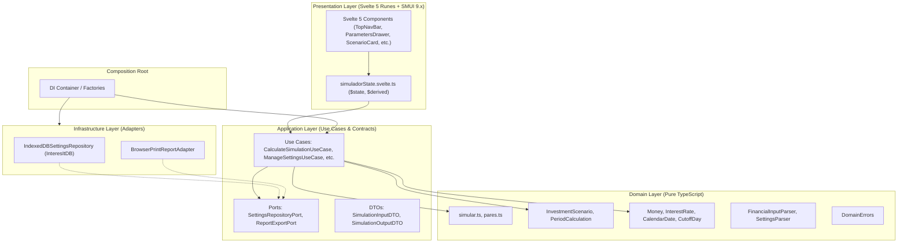

# Documento de Arquitectura de Software (Architecture Document)

> **Proyecto:** InteresIt Terminal Financiera  
> **Versión:** 2.2  
> **Estilo Arquitectónico:** Clean Architecture + Domain-Driven Design (DDD)  
> **Patrones:** Ports & Adapters (Hexagonal), Composition Root, Value Objects, Single Page Application (SPA) 100% Offline  

---

## 1. Visión y Principios del Sistema

InteresIt es una terminal financiera que proyecta el crecimiento del capital en el tiempo mediante interés compuesto multiescenario, calculando fechas exactas de calendario, días reales transcurridos por período y días de corte bancario.

### Principios Rectores:
1. **Independencia del Dominio:** Las reglas matemáticas y financieras residen en el **Domain Layer** sin dependencias de Svelte, del navegador ni de librerías externas.
2. **Dirección de Dependencias Hacia Adentro:** El flujo de control apunta hacia el dominio; las capas externas dependen de las internas mediante contratos e interfaces abstractas (Inversión de Dependencias).
3. **Seguridad Estricta de Tipos:** Prohibición absoluta de `any` y `as SomeType`. Validación de datos externos mediante funciones parser tipadas (`Result<T, E>`).
4. **Resiliencia Offline:** Persistencia 100% en el cliente mediante IndexedDB nativo y funcionamiento autónomo como Progressive Web App (PWA).

---

## 2. Capas de la Arquitectura

### 2.1. Domain Layer (`src/lib/domain/`)
- **Responsabilidad:** Representa la lógica pura y el corazón financiero del negocio.
- **Componentes:**
  - `finance/simular.ts`: Algoritmo de proyección temporal sobre base 365 y días reales.
  - `finance/pares.ts`: Generación combinatoria sin repetición $n(n-1)/2$.
  - `value-objects/`: Clases inmutables con validación en creación (`Money`, `InterestRate`, `CalendarDate`, `CutoffDay`).
  - `entities/`: Modelos con identidad (`InvestmentScenario`).
  - `parsers/`: Funciones puras que transforman entradas externas no confiables en tipos de dominio.
- **Restricciones:** Cero dependencias externas. No importa nada de `$application`, `$infrastructure` ni `$presentation`.

### 2.2. Application Layer (`src/lib/application/`)
- **Responsabilidad:** Orquestar los flujos de trabajo del usuario consumiendo el dominio y comunicándose con el exterior a través de puertos.
- **Componentes:**
  - `use-cases/`: `CalculateSimulationUseCase`, `CalculatePairMatrixUseCase`, `LoadSettingsUseCase`, `SaveSettingsUseCase`.
  - `ports/`: `SettingsRepositoryPort`, `ReportExportPort`.
  - `dtos/`: Objetos planos de transferencia tipados para desacoplar presentación de entidades de dominio.
- **Restricciones:** No contiene lógica de renderizado ni detalles de base de datos. Solo depende de `$domain`.

### 2.3. Infrastructure Layer (`src/lib/infrastructure/`)
- **Responsabilidad:** Proveer las implementaciones técnicas a los puertos definidos por la aplicación.
- **Componentes:**
  - `persistence/IndexedDBSettingsRepository.ts`: Implementación nativa con Promises sobre la base `InteresItDB` y el object store `settings`.
  - `export/PrintExportAdapter.ts`: Adaptador para generación e impresión del reporte A4.
- **Restricciones:** Depende de `$application` para implementar sus puertos y de `$domain` para los tipos.

### 2.4. Presentation Layer (`src/lib/presentation/`)
- **Responsabilidad:** Renderizar la interfaz institucional con Svelte 5 y Svelte Material UI (SMUI 9.x), gestionar interacciones de usuario y reflejar el estado reactivo.
- **Componentes:**
  - `state/simuladorState.svelte.ts`: Clase reactiva basada en runes (`$state`, `$derived`) que orquesta las llamadas a los casos de uso.
  - `components/`: Componentes modulares con límite de 450 líneas (warning) y 600 líneas (error).
- **Restricciones:** No realiza cálculos financieros directos ni accede a IndexedDB directamente. Consume casos de uso.

### 2.5. Composition Root (`src/lib/di/`)
- **Responsabilidad:** Punto único donde se instancian los repositorios y adaptadores y se inyectan en los casos de uso correspondientes mediante fábricas tipadas (`Container.ts`).
