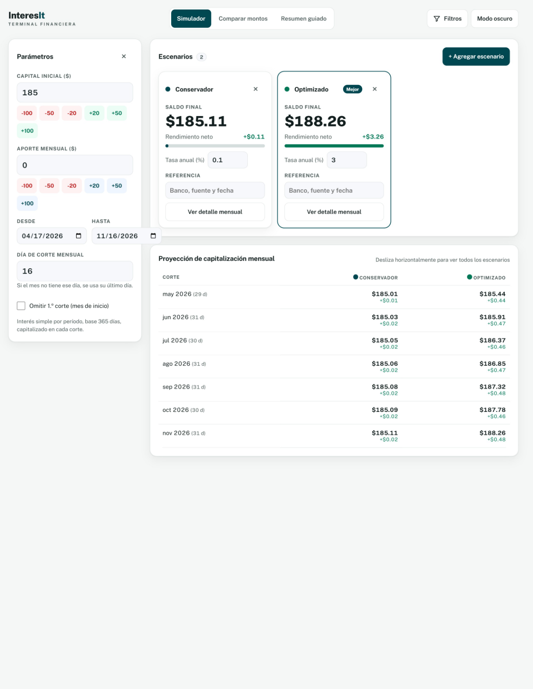
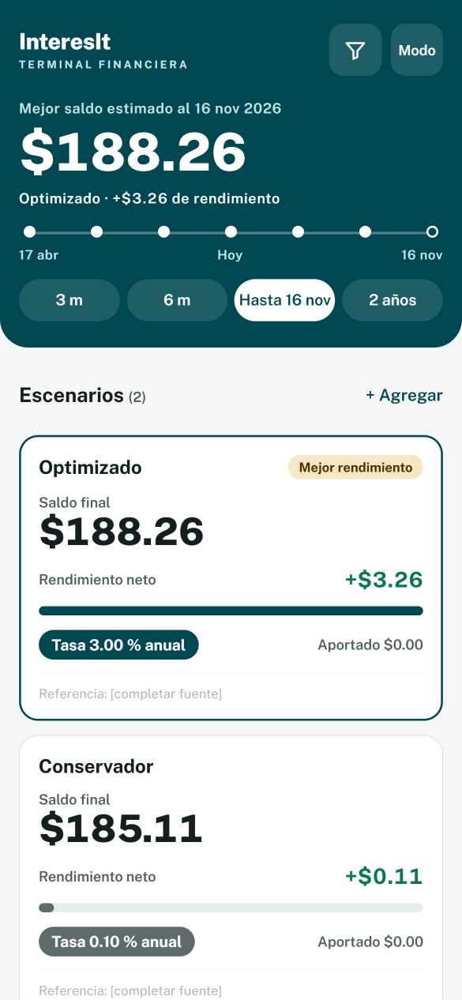
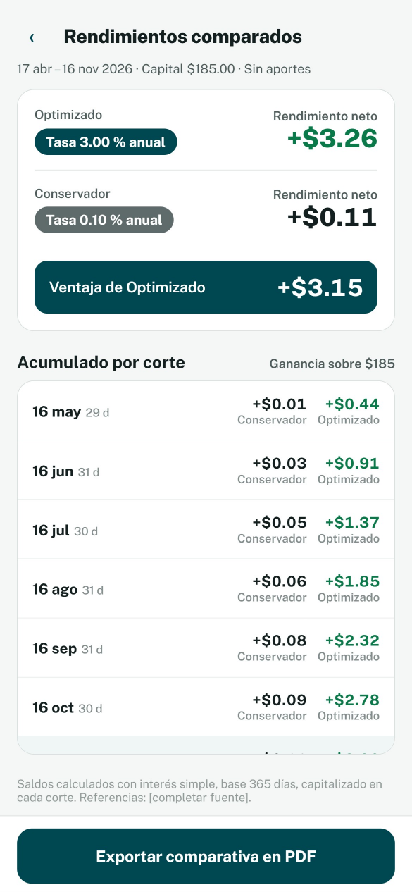
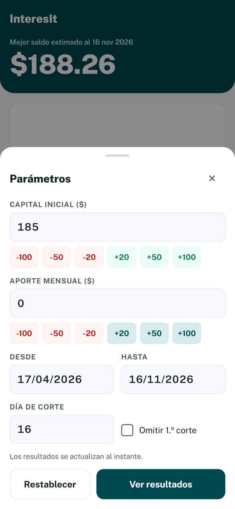
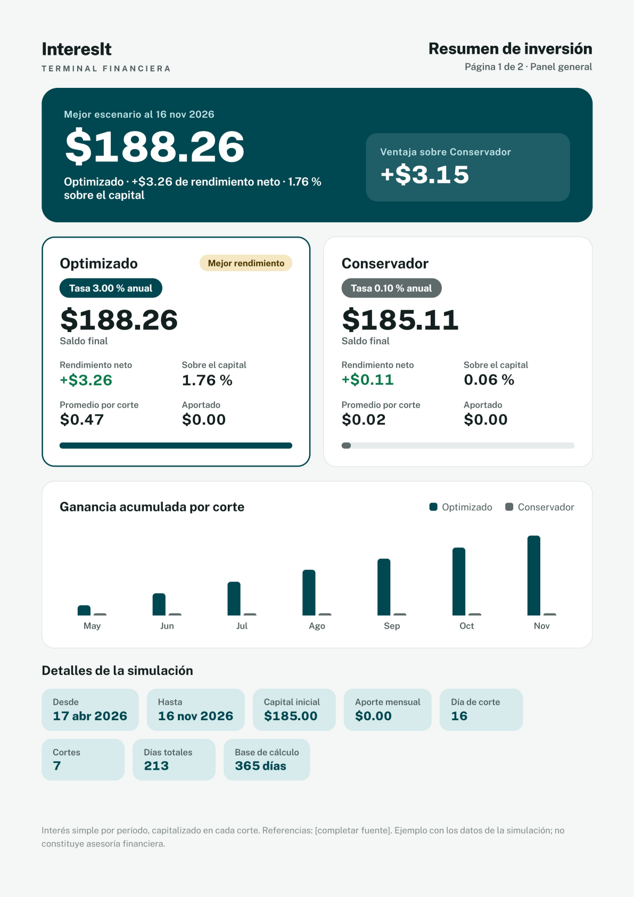
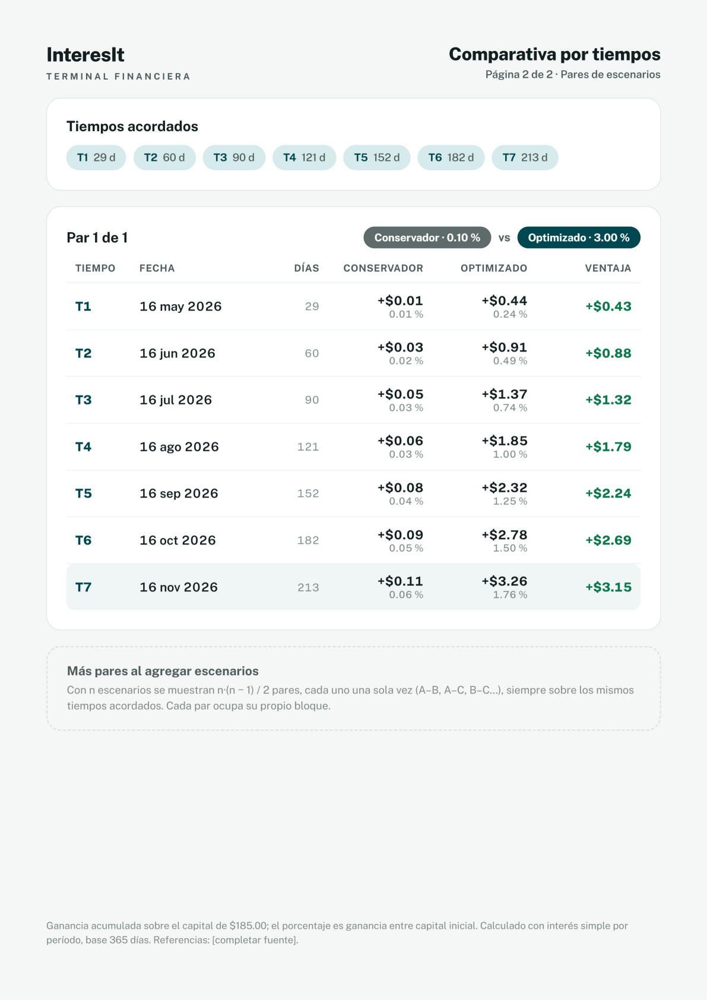
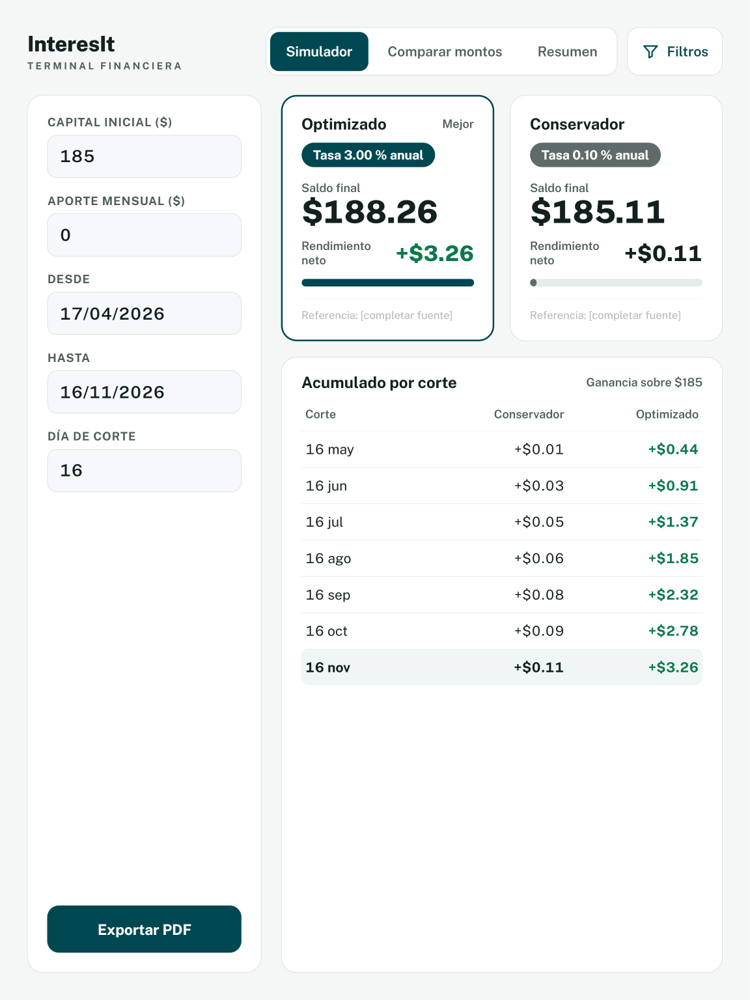

# Guía de Interfaz Visual y Tokens de Diseño (Visual Interface Guide)

> **Proyecto:** InteresIt Terminal Financiera  
> **Versión de Diseño:** 2.2 / 3.1  
> **Inspiración Estética:** Identidad Institucional de Fondos de Inversión (Excel SAFI)  
> **Librería de Componentes:** Svelte Material UI (SMUI 9.x)  
> **Tipografía:** Public Sans con cifras tabulares (`font-variant-numeric: tabular-nums`)  

---

## 1. Fundamentos y Sistema de Diseño

El rediseño de **InteresIt** eleva la aplicación de un prototipo genérico a una **terminal financiera institucional**. La interfaz prioriza la claridad jerárquica de la información:
1. **El saldo final acumulado y la ventaja monetaria neta** ocupan el primer nivel de lectura.
2. **Cifras tabulares monoespaciadas:** Todas las cantidades monetarias, porcentajes y fechas utilizan cifras tabulares para evitar saltos visuales durante la interacción.
3. **Contraste accesible:** Cumplimiento estricto con las directrices WCAG 2.1 AA tanto en modo claro como en modo oscuro.

---

## 2. Paleta de Colores y Tokens Institucionales

```scss
// Tokens Principales (Excel SAFI Institutional Palette)
$theme-primary: #004851;         // Teal profundo institucional (Excel SAFI)
$theme-primary-container: #D7EBEC;
$theme-on-primary-container: #00292E;

$theme-secondary: #5E6B6A;       // Pizarra institucional
$theme-surface: #FFFFFF;
$theme-surface-muted: #F6F8FB;
$theme-background: #F5F7F6;

$theme-tertiary: #F6E7C3;        // Dorado suave para badge de "Mejor rendimiento"
$theme-on-tertiary: #4A3500;

$theme-positive: #0B7A4B;        // Verde dinero institucional para ganancias
$theme-negative: #B42318;        // Carmesí para reducciones o alertas

$theme-outline: #D5DEDC;
$theme-ink: #14201F;
$theme-ink-muted: #4F5D5C;

// Modo Oscuro
$theme-primary-dark: #7FD1D8;
$theme-background-dark: #0B1120;
$theme-surface-dark: #131C30;
$theme-outline-dark: #26334E;
$theme-ink-dark: #E7EEF8;
$theme-ink-muted-dark: #A3B0C6;
```

---

## 3. Catálogo de Vistas e Interfaces de Usuario

### 3.1. Simulador Principal en Escritorio (Desktop Simulator)

La vista principal de escritorio organiza la experiencia en un panel lateral izquierdo de parámetros (`Data Entry`) y un área de trabajo central con las tarjetas de los escenarios evaluados y la tabla de proyección de capitalización mensual.



#### Componentes Clave:
- **Panel Lateral de Parámetros:** Entradas numéricas con chips de adición/sustracción rápida (`-100`, `-50`, `-20`, `+20`, `+50`, `+100`), selectores de fecha (`Desde`, `Hasta`), día de corte bancario y checkbox para omitir el primer corte.
- **Tarjetas de Escenarios (`ScenarioCardSMUI`):** Tarjetas con elevación sutil; el escenario con mejor rendimiento recibe un borde distintivo de 2px en `#004851`, badge dorado y etiqueta "Mejor".
- **Tabla de Capitalización (`ProjectionTableSMUI`):** Desglose por corte mensual indicando los días exactos transcurridos por período (ej. `29 d`, `31 d`, `30 d`), el saldo acumulado y la ganancia neta devengada.

---

### 3.2. Experiencia Móvil: Hero Card y Escenarios

En dispositivos móviles, el espacio vertical se aprovecha mediante una tarjeta Hero prominente en `#004851` que exhibe el mejor saldo final estimado y la ganancia neta obtenida.



#### Características:
- **Barra Superior Institucional:** Logo oficial de InteresIt y botón de acceso directo a filtros.
- **Tarjeta Hero:** Saldo estimado en display de 44px (`$188.26`), subtítulo con ganancia neta (`+$3.26 de rendimiento`) y selector de horizonte rápido en píldoras (`3 m`, `6 m`, `Hasta 16 nov`, `2 años`).
- **Lista Vertical de Escenarios:** Tarjetas individuales para cada instrumento con chip de tasa anual, capital aportado y referencia bancaria.

---

### 3.3. Rendimientos Comparados en Móvil

Vista enfocada en el análisis directo de ventajas financieras entre dos o más instrumentos.



#### Elementos Destacados:
- **Banner de Ventaja Monetaria:** Cuadro destacado en Teal institucional que cuantifica el diferencial exacto: `Ventaja de Optimizado: +$3.15`.
- **Lista de Acumulado por Corte:** Comparación período por período entre el competidor base y el optimizado.
- **Acción Flotante:** Botón primario de ancho completo `Exportar comparativa en PDF`.

---

### 3.4. Drawer / Modal Móvil de Parámetros

El ingreso de datos en pantallas reducidas se despliega como un Bottom Sheet modal con scrim inferior, facilitando la edición con una sola mano.



#### Interacciones:
- Selector de capital inicial y aportes recurrentes con chips dinámicos táctiles.
- Formato de fechas en calendario estándar.
- Botones de acción inferior: `Restablecer` (secundario) y `Ver resultados` (primario de alto contraste).

---

### 3.5. Reporte Ejecutivo A4 — Página 1: Panel General

Diagramado con reglas CSS nativas (`@media print`) sobre tamaño de hoja A4 exacto ($210 \times 297\text{ mm}$), listo para guardarse como PDF o imprimirse físicamente con calidad de imprenta.



#### Estructura:
1. **Encabezado Institucional:** Logotipo, nombre comercial y título `Resumen de inversión — Página 1 de 2 · Panel general`.
2. **Hero de Ventaja Competitiva:** Tarjeta combinada con el mejor escenario y el bloque monetario de ventaja sobre el conservador (`+$3.15`).
3. **Tarjetas de Escenarios Comparados:** Desglose del rendimiento porcentual sobre el capital ($1.76\%$ vs $0.06\%$) y promedio ganado por corte mensual.
4. **Gráfico de Barras de Ganancia Acumulada:** Histograma visual mes a mes que evidencia la divergencia exponencial generada por el interés compuesto.
5. **Ficha Técnica de la Simulación:** Resumen de parámetros base (fechas, capital inicial, número de cortes y base de cálculo 365 días).

---

### 3.6. Reporte Ejecutivo A4 — Página 2: Matriz Comparativa de Pares

La segunda página del informe formaliza el análisis matemático exhaustivo contrastando todos los escenarios según la combinatoria $n(n-1)/2$.



#### Estructura:
1. **Encabezado de Página 2:** Identificador `Comparativa por tiempos — Página 2 de 2 · Pares de escenarios`.
2. **Tiempos Acordados:** Chips con hitos temporales acumulados en días reales ($T_1: 29\text{ d}$, $T_2: 60\text{ d}$, $T_3: 90\text{ d}$, $\dots$, $T_7: 213\text{ d}$).
3. **Tabla Matricial del Par:**
   - Columnas: Hito temporal, Fecha de corte, Días transcurridos, Ganancia en Escenario A, Ganancia en Escenario B y Columna de Ventaja en Verde Institucional (`#0B7A4B`).
4. **Nota Técnica Institucional:** Cita al pie detallando la base de cálculo de 365 días y aclaración de no asesoría financiera personalizada.

---

### 3.7. Vista Adaptativa para Tablets

En tabletas o ventanas medianas (entre $768\text{ px}$ y $1024\text{ px}$), la interfaz se reorganiza en un diseño de dos columnas fluidas sin saturar la pantalla.



---

## 4. Resumen de Archivos de Imagen Generados

Todas las capturas y mockups de alta fidelidad han sido renderizados a resolución $2\times$ y están disponibles en la carpeta `imgs/`:

| Archivo | Dimensiones | Descripción |
| :--- | :---: | :--- |
| `imgs/desktop_simulator_overview.png` | $1224 \times 1584$ | Vista de simulador completo para escritorio |
| `imgs/mobile_simulator_hero.png` | $585 \times 1266$ | Pantalla móvil con tarjeta Hero institucional |
| `imgs/mobile_comparison_view.png` | $585 \times 1266$ | Pantalla móvil de rendimientos comparados y ventaja |
| `imgs/mobile_parameters_drawer.png` | $585 \times 1266$ | Modal / Bottom Sheet de parámetros con chips interactivos |
| `imgs/report_a4_dashboard_page1.png` | $1191 \times 1684$ | Página 1 del reporte ejecutivo A4 (Panel General) |
| `imgs/report_a4_pair_comparison_page2.png` | $1191 \times 1684$ | Página 2 del reporte ejecutivo A4 (Matriz de Pares) |
| `imgs/tablet_simulator_view.png` | $1152 \times 1536$ | Vista adaptada para tablets y pantallas medianas |
| `imgs/app_logo.webp` / `app_logo.png` | Alta resolución | Logotipo oficial de InteresIt |
