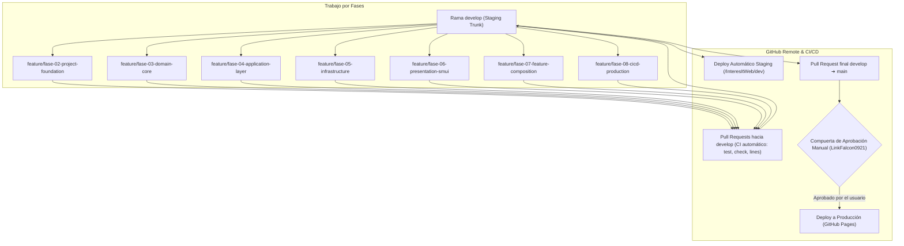

# Plan Estratégico de Migración Definitivo (Migration Plan v3.1)

> **Proyecto:** InteresIt Terminal Financiera  
> **Versión del Plan:** 3.1 (Alineado vía `/grill-me` y Plan Maestro v2.2)  
> **Stack Base:** Node.js 24 LTS | TypeScript 7 (Strict) | Svelte 5 (Runes) | SvelteKit (`adapter-static`) | Svelte Material UI (SMUI 9.x) | Sass | pnpm 12 | Vitest | Driver.js | GitHub Actions  
> **Fecha:** 2026-11-07  

---

## 1. Principio Rector y Gobernanza

La migración se ejecuta de forma **estrictamente incremental por fases verticales**, donde ninguna fase avanza sin haber validado sus propios criterios de aceptación, pruebas unitarias, límites físicos de líneas y revisión de calidad.

El monolito original (`index.html`) se preserva intacto durante las fases 1 a 6 como baseline de comparación y caracterización, y se retira en la fase de composición y release (Fase 7 y 8).

---

## 2. Flujo Git y Entornos CI/CD

El repositorio opera bajo un modelo de ramas y compuertas de seguridad automáticas y manuales:

### Decisiones de Gobernanza:
1. **Tronco de Integración (`develop`):** Toda nueva funcionalidad se mergea contra `develop` mediante Pull Requests. Al completarse el merge, GitHub Actions ejecuta el despliegue automático a Staging (`/InteresItWeb/dev`).
2. **Rama de Producción (`main`):** El pase a `main` se realiza mediante Pull Request desde `develop` y requiere aprobación explícita en GitHub Environments (*Required Reviewer: `LinkFalcon0921`*).
3. **CI Obligatorio en PRs:** Todo PR debe superar en verde:
   - `pnpm test` (pruebas unitarias Vitest).
   - `pnpm check` (verificación estricta de tipos de Svelte/TypeScript).
   - `pnpm run check:lines` (límite de 600 líneas físicas por archivo).
   - `pnpm build` (compilación estática sin errores).

---

## 3. Mapa Detallado de Fases

### FASE 0 — Discovery & Legacy Audit
- **Estado:** COMPLETED.
- **Entregables:** Auditoría del monolito `index.html`, extracción de fórmulas financieras, identificación de variables de estado y persistencia `IndexedDB`.

### FASE 1 — Architecture & Technical Decisions
- **Estado:** COMPLETED.
- **Entregables:** ADR-001 a ADR-006, especificación de Clean Architecture (`$domain`, `$application`, `$infrastructure`, `$presentation`), reglas de dependencias y catálogo de módulos.

### FASE 2 — Project Foundation & Quality Tooling (PR 1)
- **Estado:** COMPLETED.
- **Entregables:** Configuración de `package.json` con `pnpm 12`, `svelte.config.js` (`adapter-static`), `vite.config.ts`, `tsconfig.json` (strict TS 7), `smui-theme` con Sass, `@fontsource/public-sans`, Vitest y script `scripts/check-lines.js`.

### FASE 3 — Domain Migration: Financial Core v2.2 (PR 2)
- **Estado:** COMPLETED.
- **Entregables:** `simular.ts` (fechas exactas en UTC, base 365, día de corte con clamping mensual, retención fiscal RD del 10%), `pares.ts` (combinatoria $n(n-1)/2$), Value Objects (`Money`, `InterestRate`, `CutoffDay`, `CalendarDate`), parsers `Result<T, E>` y suite de 43 pruebas en Vitest.

### FASE 4 — Application Layer: Casos de Uso y Contratos (PR 3)
- **Estado:** COMPLETED.
- **Entregables:** DTOs (`SimulationInputDTO`, `SimulationOutputDTO`, `PairMatrixDTO`, `SettingsDTO`), Puertos (`SettingsRepositoryPort`, `ReportExportPort`), Casos de uso (`CalculateSimulationUseCase`, `CalculatePairMatrixUseCase`, `LoadSettingsUseCase`, `SaveSettingsUseCase`) y 26 pruebas unitarias adicionales en Vitest (Total: 69 tests pasando).

### FASE 5 — Infrastructure & Adapters (PR 4)
- **Estado:** SIGUIENTE PASO (NEXT).
- **Objetivo:** Implementar persistencia y adaptadores de servicios externos.
- **Actividades:**
  1. `IndexedDBSettingsRepository.ts`: persistencia asíncrona nativa sobre `InteresItDB` y el object store `settings`.
  2. `PrintExportAdapter.ts`: adaptador para emisión y visualización del reporte A4 de 2 páginas con estilos `@media print`.
  3. Pruebas de integración con `fake-indexeddb`.

### FASE 6 — Presentation Layer: Svelte 5 Runes & SMUI (PR 5)
- **Estado:** PLANIFICADA.
- **Objetivo:** Construir los componentes visuales institucionales con Svelte Material UI y Runes.
- **Actividades:**
  1. Shell: `TopNavBar.svelte`, `ParametersDrawer.svelte` (modal móvil / persistente desktop), `TabNavigation.svelte`.
  2. Simulador: `ScenarioCardSMUI.svelte`, `RateChipSMUI.svelte`, `AdvantagePaper.svelte`, `ProjectionTableSMUI.svelte`.
  3. Vistas Complementarias: `AmountMatrixTable.svelte`, `GuidedSummaryCards.svelte`.
  4. Vistas de Impresión A4: `ExportSummaryA4.svelte`, `DashboardA4Page.svelte`, `PairComparisonA4Page.svelte`.
  5. Store Reactivo: `simuladorState.svelte.ts` con Runes (`$state`, `$derived`).
  6. Tutorial interactivo paso a paso con `driver.js`.

### FASE 7 — Feature Migration & DI Composition (PR 6)
- **Estado:** PLANIFICADA.
- **Objetivo:** Ensamblar la aplicación completa en el Composition Root y activar Service Worker.
- **Actividades:**
  1. Composition Root: `src/lib/di/Container.ts`.
  2. Ensamble de la SPA en `src/routes/+page.svelte` y `+layout.svelte`.
  3. Service Worker PWA para resiliencia offline.

### FASE 8 — CI/CD Production Workflows, Lighthouse & Release (PR 7)
- **Estado:** PLANIFICADA.
- **Objetivo:** Auditoría final de accesibilidad, validación CI/CD y despliegue a producción.
- **Actividades:**
  1. Auditoría Lighthouse (> 90 en Accesibilidad, Rendimiento, PWA).
  2. Configuración final de `.github/workflows/deploy-production.yml` con compuerta de aprobación manual (`LinkFalcon0921`).
  3. Merge de `develop` a `main` y publicación en producción.
